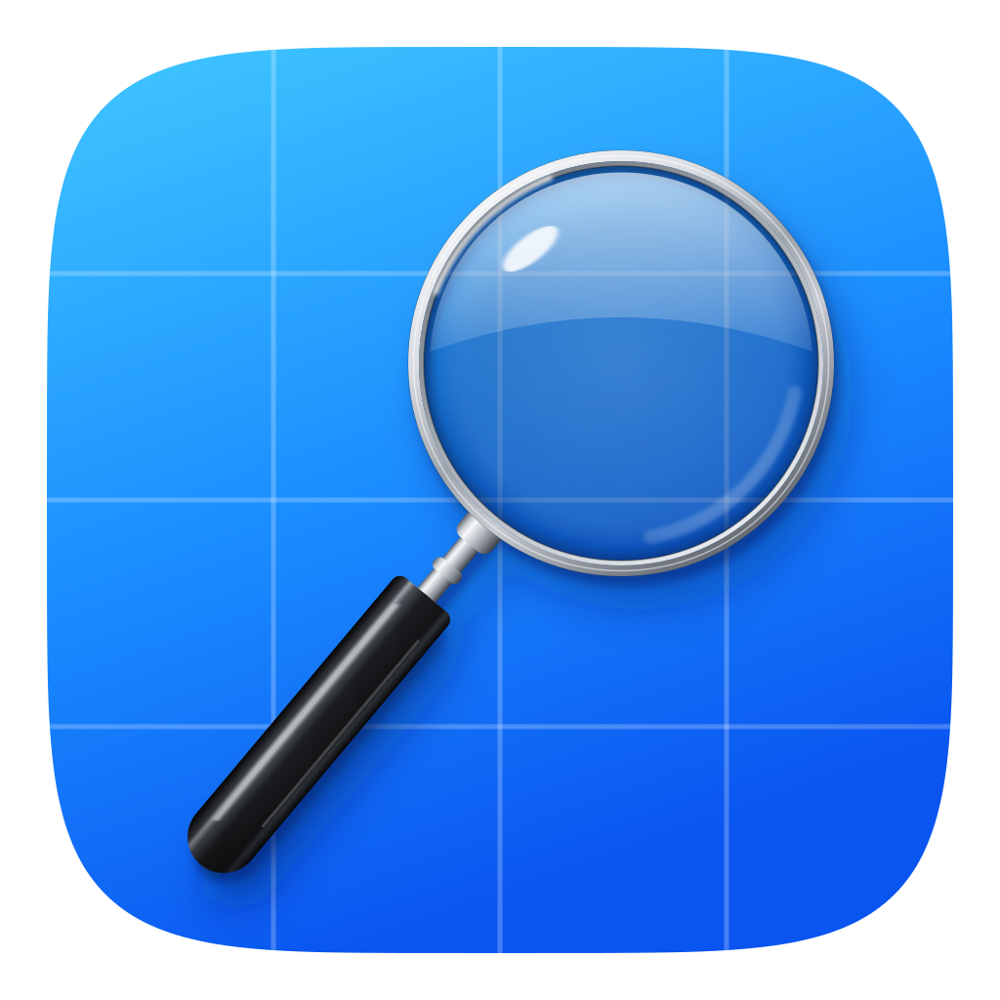

<p align="center">
  
</p>

<h1 align="center">Apple Research Skill</h1>

<p align="center">Make your AI read Apple's docs before it writes your code.</p>

---

An agent skill that makes AI research Apple frameworks before it plans or writes code. Works with any AI coding tool that supports the Agent Skills open format.

AI models learn from code written before their training cutoff, and Apple ships a new SDK every year. So agents often use deprecated APIs, guess availability, make up method names, or miss the Human Interface Guidelines. This skill makes the agent read Apple's own sources first and write what it learns into a sourced research report you can review before any code exists.

This repository is packaged as a portable Agent Plugin: compatible clients discover the skill from the root `plugin.json` and the `skills/` folder. Manifests for Claude Code, Codex and Cursor are included too.

## What it does

- Starts from the links you give it (WWDC sessions, docs pages, articles), or finds the sources itself
- Follows those pages to find more links: See Also sections, related symbols, other WWDC sessions, HIG pages and release notes
- Confirms the latest released OS and Xcode versions instead of trusting its training data
- Reads your Xcode project's deployment target and Swift settings (read only), when there is one
- Checks every detail against Apple Developer Documentation, WWDC sessions, the HIG, release notes and sample code
- Links every claim to the page it came from, and marks anything it can't confirm as **Unverified** and its own reasoning as **Inference**
- Writes one report per feature to `.docs/<feature>-research.md`, with open questions first
- Doesn't touch your code, and stops so you can review before planning

## Report structure

1. Open Questions
2. Feature Overview & Platform Scope
3. API & Technical Breakdown
4. HIG & UX Guidelines
5. Edge Cases & Limitations
6. Key Technical Takeaways
7. References

## How to Use This Skill

### Option A: Using skills.sh (recommended)

Install the skill with one command:

```bash
npx skills@latest add https://github.com/BaherTamer/apple-research-skill --skill apple-research
```

For more information, visit [skills.sh](https://skills.sh).

### Option B: Claude Code Plugin

**Personal usage**

1. Add the marketplace:

   ```
   /plugin marketplace add BaherTamer/apple-research-skill
   ```

2. Install the plugin:

   ```
   /plugin install apple-research@apple-research-skill
   ```

**Project configuration**

To give the skill to everyone working in a repository, add this to the repository's `.claude/settings.json`:

```json
{
  "enabledPlugins": {
    "apple-research@apple-research-skill": true
  },
  "extraKnownMarketplaces": {
    "apple-research-skill": {
      "source": {
        "source": "github",
        "repo": "BaherTamer/apple-research-skill"
      }
    }
  }
}
```

When team members open the project, Claude Code prompts them to install it.

### Option C: Cursor Plugin

Clone this repository into `~/.cursor/plugins/local`. Cursor reads both the portable `plugin.json` and the Cursor manifest in `.cursor-plugin/plugin.json`.

### Option D: Manual install

1. Clone this repository.
2. Copy or symlink the `skills/apple-research/` folder to where your tool keeps skills:
   - **Claude Code:** `~/.claude/skills/` for all projects, or `.claude/skills/` in one project ([docs](https://docs.claude.com/en/docs/agents-and-tools/agent-skills/overview))
   - **Codex:** [Where to save skills](https://developers.openai.com/codex/skills/#where-to-save-skills)
   - **Cursor:** [Enabling Skills](https://cursor.com/docs/context/skills#enabling-skills)
   - **Gemini CLI:** [Agent Skills](https://geminicli.com/docs/cli/skills/)

## Usage

Ask your agent to use the skill, and give it a few starting links if you have them:

```
/apple-research Add on-device AI with the Foundation Models framework. Start from these links: <links>
```

or

> Use the apple research skill to research how to make this app's actions available in Siri with App Intents.

Then review `.docs/<feature>-research.md`, answer its open questions, and use it as the base for your plan and implementation in later prompts.

In Claude Code, a skill installed as a plugin is called with the plugin's name first: `/apple-research:apple-research`.
